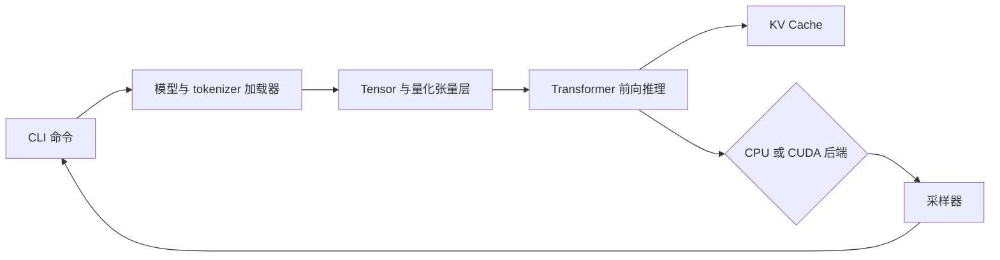
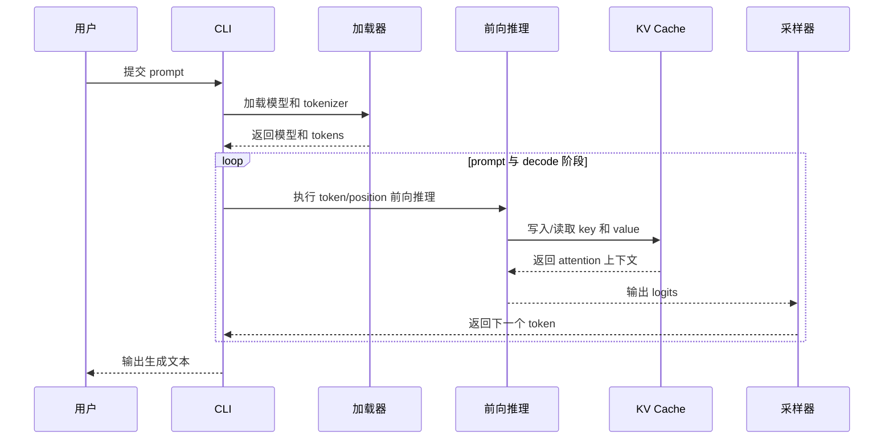

# m_mini_llam

`m_mini_llam` 是一个基于 C++17 的小型 Transformer 推理引擎。项目已支持 CPU 推理，并提供可选的 CUDA 后端。其目标是清晰展示模型执行链路：张量运算、量化线性层、GGUF 加载、分词、KV Cache、采样和命令行演示均在本仓库内实现。

## 当前状态

- CPU 后端：已实现，并由 CTest 覆盖。
- 数值正确性：使用独立 Python 参考实现对比 C++ logits 和生成 token。
- 量化：已包含 F32/模型原生权重、Q8_0、Q4_0 和 Q4_1 路径；GPU 测试覆盖三种量化 linear，以及 Q8_0/Q4_0 的 CPU/CUDA 模型对齐。
- CUDA 后端：通过 `MINI_LLAMA_CUDA=ON` 启用；已取得 RTX 4090 D、CUDA 12.6 下的核心测试、tiny 模型数值对齐及 memcheck 通过结果，详见下方实测记录。

## 编译与运行

环境要求：CMake 3.18+、支持 C++17 的编译器、用于数值对齐的 Python 3，以及常规构建工具。

```bash
cmake -S . -B build-cpu -DMINI_LLAMA_CUDA=OFF -DMINI_LLAMA_BUILD_TESTS=ON
cmake --build build-cpu --parallel
ctest --test-dir build-cpu --output-on-failure < /dev/null
```

运行 tiny 模型： 

```bash
./build-cpu/mini-llama generate \
  --model models/tiny/model.bin \
  --config models/tiny/model.json \
  --tokenizer models/tiny/vocab.json \
  --backend cpu --prompt "hello" --n-predict 8
```

可执行文件还提供 `run`、`inspect`、`inspect-gguf` 和 `bench` 命令。可通过 `./build-cpu/mini-llama --help` 或各子命令的 `--help` 查看参数。

## CPU 一键验证

以下命令会自动配置 CPU 构建、运行 CPU CTest（含 Python logits/token 对齐）。聊天冒烟测试使用 EOF 退出，不等待终端输入：

```bash
python3 python/run_cpu_tests.py
```

每次运行写入 `result/Cpu_result.md`，保留命令、输出和通过/失败状态。当前脚本不自动运行性能 benchmark。异地 CMake 缓存会被保留，脚本另建目录完成构建。`result/` 已被 Git 忽略；报告会覆盖，应按需归档，且不要同时启动多份测试。

## 目录结构

- `include/`、`src/`：推理引擎接口和实现
- `test/`：CPU、CUDA、tokenizer、KV Cache 和前向推理测试
- `python/`：独立参考实现、数值对齐和测试脚本
- `models/tiny/`：用于测试和示例的小型可复现模型
- `models/chat/`：可用时加载聊天模型和 tokenizer 资源

## 架构与数据流





## 技术取舍与 CPU 实测

以下 CPU 性能数字为历史记录，不是本次 4090D 测试的新测量结果，当前一键脚本也不会重新生成这些 benchmark 数字。

- **可读参考路径与最大吞吐**：显式保留张量形状和参数校验，便于验证 CPU/CUDA 对齐；代价是部分路径会增加检查和拷贝。
- **量化与数值精度**：tiny 模型的单线程 `RelWithDebInfo` 结果为：原生权重 `146.31` tokens/s、`0.13 MB`；Q8_0 为 `204.75` tokens/s、权重压缩 `2.74x`、最大 logits 误差 `7.412e-4`；Q4_0 为 `282.06` tokens/s、压缩 `3.94x`、最大误差 `1.308e-2`。低精度减少了内存占用，并提高了该样本的速度，但增大了数值误差。
- **独立 Python 参考实现与测试复杂度**：对齐测试逐步比较 logits 和生成 token。当前 CPU 测试覆盖 2 个 prompt、20 个推理步骤，C++ 与 Python 路径的最大绝对误差为 `4.47e-8`。

## CUDA 验证

在具备受支持 NVIDIA GPU、CUDA Toolkit 和 compute-sanitizer 的设备上执行：

```bash
# 4090D：CPU + GPU 完整验证
python3 python/run_all_tests.py --arch 89
# 或仅执行 GPU 验证
python3 python/run_gpu_tests.py --arch 89
```

GPU 脚本强制重新编译，实时显示输出并记录 attention 源码 SHA-256。默认执行 compute-sanitizer **memcheck**；只有显式传入 `--skip-sanitizer` 才跳过，跳过后的 PASS 不包含显存检查。

结果保存在 `result/Final_result.md`、`Cpu_result.md`、`Gpu_result.md`，阶段日志包括真实 GGUF 生成、memcheck、racecheck 和 synccheck（`04-real-gguf-generate.log` 至 `08-compute-sanitizer-synccheck.log`），总运行输出为 `Cpu_runner.log` 和 `Gpu_runner.log`。某阶段失败会阻断后续 GPU 阶段。

### 4090D 实测结果（2026-09-16）

本节同时包含 tiny kernel 回归和真实 Qwen2 GGUF 结果。tiny 主要验证 CUDA kernel 与数值对齐；Qwen2 结果用于展示真实模型的加载、生成和 CPU/GPU 方向性差异。

仙宫云 NVIDIA GeForce RTX 4090 D，显存约 23.54 GiB，计算能力 8.9，CUDA Toolkit 12.6；报告完成时间为北京时间 20:54:36（UTC 12:54:36）。执行完整默认命令，CPU/GPU 退出码均为 0，总结果 PASS。

| 验证项目 | 本次结果 |
| --- | --- |
| CPU CTest | 7/7 PASS，含独立 Python 模型对齐；聊天项为 EOF 冒烟 |
| GPU CTest | 2/2 PASS，合计 2.78 秒（不含构建和 sanitizer） |
| GPU 核心测试 | matmul、逐元素算子、Normal/NeoX RoPE、Q8_0/Q4_0/Q4_1 linear、KV cache 通过 |
| 并行 GQA attention | head_dim=7/128/129 × pos=0/4/126/127/128/256，共 18 组；host/device 入口均检查 |
| tiny 模型对齐 | F32 CPU/CUDA/Python，以及 Q8_0/Q4_0 CPU/CUDA 通过 |
| memcheck：核心测试 | ERROR SUMMARY: 0 errors |
| memcheck：CUDA 生成 | ERROR SUMMARY: 0 errors，生成 token [61, 92] |
| 真实 Qwen2 GGUF | 加载、CUDA 生成和 tokenizer 通过；生成文本为“我是一个AI，没有个人感受” |
| 真实 Qwen2 GPU prefill | 875.680 ms / 7 tokens = **7.99 tokens/s** |
| 真实 Qwen2 GPU decode | 128.014 ms / 7 steps = **54.68 tokens/s** |
| 真实 Qwen2 GPU 内存埋点 | 1401.48 MB；不等同于设备峰值显存 |

已核对 attention 源码 SHA-256 为 `d7855b2fcf207cc41b0b5db0ed5bee8eed2428ae9cd4efb425c568399b27f057`，对应恢复并行点积与两阶段并行 softmax 的版本。上述数据来自本次云端报告，详见 `TEST_REPORT.md` 第 20 节。

#### 同一真实模型的 CPU/GPU 方向性对比

使用同一 Qwen2-0.5B-Instruct-Q8_0 GGUF、同一中文 prompt、temperature=0、seed=1 和 8 个生成 token。CPU 使用 14 threads；GPU 使用云端 RTX 4090 D、host threads=1。两端生成 token 和文本一致。

| 指标 | CPU（14 threads，本地） | GPU（RTX 4090 D，云端） | GPU/CPU |
| --- | ---: | ---: | ---: |
| Prefill | 24886.374 ms / **0.2815 tokens/s** | 875.680 ms / **7.99 tokens/s** | **28.38x** |
| Decode | 14086.460 ms / **0.4969 tokens/s** | 128.014 ms / **54.68 tokens/s** | **9.01x** |

这是一组单次冷运行的方向性结果：CPU 与 GPU 的硬件环境不同，线程配置也不同，尚未经过 5 次预热、30 次重复、p95、CPU RSS 和 GPU 峰值显存测量。因此这些数字适合说明测试方法和量级，不应视为稳定性能承诺；正式性能应使用 `python/benchmark_backends.py` 生成 raw timings 后再更新。

CTest 默认不打印成功用例的详细误差，因此本批日志未保留模型对齐的实测最大误差；不可将测试容差作为实测误差。需要留存逐步 logits 时，可另行执行：

```bash
python3 python/test_gpu_alignment.py --binary build-gpu/mini-llama --keep-output result/logits
```

### 后续建议测试（尚未完成）

- 增加真实 GGUF 模型端到端 CPU/GPU 对齐、Q4_1 模型生成，以及长上下文和多轮聊天；当前真实模型已完成 GPU smoke test，但还没有完整 CPU/GPU logits 对齐。
- 单独进行无 sanitizer 的预热、多轮性能测量，记录 prefill/decode 吞吐、峰值显存及持续运行的显存变化；本次 sanitizer 耗时不作为性能指标。
- 条件允许时增加多 GPU 设备错误路径与其他显卡/工具链验证。当前实机结论限定于 4090D + CUDA 12.6。

## 已知限制

tiny 模型只是正确性测试样本，不代表真实模型的生成质量或性能。性能数据会受编译器、CPU、线程数、模型和构建类型影响；GPU 数据必须与显卡型号和 CUDA 版本一起报告。
