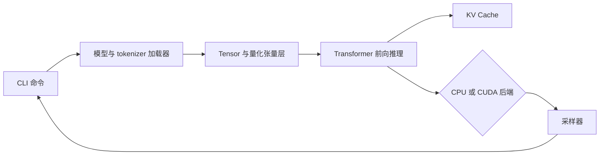
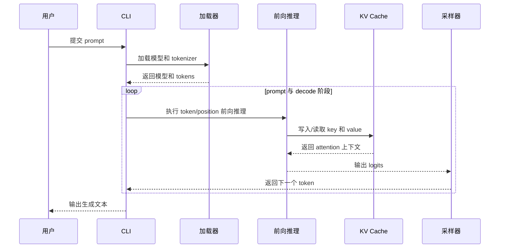

# m_mini_llam

`m_mini_llam` 是一个基于 C++17 的小型 Transformer 推理引擎。项目已支持 CPU 推理，并提供可选的 CUDA 后端。其目标是清晰展示模型执行链路：张量运算、量化线性层、GGUF 加载、分词、KV Cache、采样和命令行演示均在本仓库内实现。

## 当前状态

- CPU 后端：已实现，并由 CTest 覆盖。
- 数值正确性：使用独立 Python 参考实现对比 C++ logits 和生成 token。
- 量化：已包含 F32/模型原生权重、Q8_0、Q4_0 和 Q4_1 路径；GPU 测试覆盖三种量化 linear，以及 Q8_0/Q4_0 的 CPU/CUDA 模型对齐。
- CUDA 后端：通过 `MINI_LLAMA_CUDA=ON` 启用；完成 RTX 4090 D、CUDA 12.6 下的核心测试、tiny 模型数值对齐及 memcheck 通过。

## 编译与运行

环境要求：CMake 3.18+、支持 C++17 的编译器、用于数值对齐的 Python 3，以及常规构建工具。

```bash
cmake -S . -B build-cpu -DMINI_LLAMA_CUDA=OFF -DMINI_LLAMA_BUILD_TESTS=ON
cmake --build build-cpu --parallel
ctest --test-dir build-cpu --output-on-failure < /dev/null
```

运行 tiny 模型： 

```bash
./build-cpu/mini-llama generate \
  --model models/tiny/model.bin \
  --config models/tiny/model.json \
  --tokenizer models/tiny/vocab.json \
  --backend cpu --prompt "hello" --n-predict 8
```

可执行文件还提供 `run`、`inspect`、`inspect-gguf` 和 `bench` 命令。可通过 `./build-cpu/mini-llama --help` 或各子命令的 `--help` 查看参数。

## CPU 一键验证

以下命令会自动配置 CPU 构建、运行 CPU CTest（含 Python logits/token 对齐）。聊天冒烟测试使用 EOF 退出，不等待终端输入：

```bash
python3 python/run_cpu_tests.py
```


## 目录结构

- `include/`、`src/`：推理引擎接口和实现
- `test/`：CPU、CUDA、tokenizer、KV Cache 和前向推理测试
- `python/`：独立参考实现、数值对齐和测试脚本
- `models/tiny/`：用于测试和示例的小型可复现模型
- `models/chat/`：可用时加载聊天模型和 tokenizer 资源

## 架构与数据流





## CUDA 验证

在具备受支持 NVIDIA GPU、CUDA Toolkit 和 compute-sanitizer 的设备上执行：

```bash
# 4090D：CPU + GPU 完整验证
python3 python/run_all_tests.py --arch 89
# 或仅执行 GPU 验证
python3 python/run_gpu_tests.py --arch 89
```

GPU 脚本强制重新编译，实时显示输出并记录 attention 源码 SHA-256。默认执行 compute-sanitizer **memcheck**；只有显式传入 `--skip-sanitizer` 才跳过，跳过后的 PASS 不包含显存检查。

结果保存在 `result/Final_result.md`、`Cpu_result.md`、`Gpu_result.md`，阶段日志包括真实 GGUF 生成、memcheck、racecheck 和 synccheck（`04-real-gguf-generate.log` 至 `08-compute-sanitizer-synccheck.log`），总运行输出为 `Cpu_runner.log` 和 `Gpu_runner.log`。某阶段失败会阻断后续 GPU 阶段。

### Colab T4 推理优化实测（2026-11-19）

在同一台 Colab Tesla T4（15 GiB、CUDA Toolkit 13.0、Release / sm_75）上，以同一份 `Qwen2-0.5B-Instruct-Q8_0.gguf`、同一二进制和固定种子对照。两项开关均关闭作为基线，共采集 **210 条热态样本**。模型加载和请求上下文初始化单独计时，推理总耗时为首 token 时间与后续 Decode 时间之和。

- `MINI_LLAMA_CUDA_BATCH_PREFILL=1` 按最多 128 个连续 token 分块执行提示词前向，只对提示词的最后一个位置计算 logits。
- `MINI_LLAMA_CUDA_GREEDY=1` 在设备端取最大 logits 的索引。两项优化默认关闭。

#### 短提示词四批对照

使用中文提示词「你好，请用一句话介绍自己。」，输入 7 个 token，生成 8 个 token，实际 Decode 7 步。每种配置测 4 批，每批 8 次，轮换测试顺序。下表单位为毫秒。

| 开关组合 | Prefill p50 | Prefill p95 | 首 token p50 | Decode p50 | 推理总耗时 p50 |
| --- | ---: | ---: | ---: | ---: | ---: |
| 逐 token + CPU 采样 | 182.13 | 195.23 | 182.56 | 185.02 | 368.09 |
| 仅批量 Prefill | 60.97 | 63.60 | 61.42 | 188.49 | 249.89 |
| 仅 GPU 贪心 | 181.78 | 199.67 | 181.82 | 179.39 | 361.55 |
| 两项同时开启 | 60.57 | 63.32 | 60.62 | 182.80 | 243.59 |

批量 Prefill 单开时，Prefill 中位耗时从 **182.13 ms** 降到 **60.97 ms**，约 **2.99 倍**。两项同时开启时，首 token 中位耗时从 **182.56 ms** 降到 **60.62 ms**，推理总耗时下降 **33.82%**。

#### 不同输入长度的 Prefill

使用指定数量的 BOS token 构造输入，生成 1 个 token 即结束。每行比较逐 token 与批量 Prefill 的中位耗时，两组都用 CPU 采样。1024-token 每组仅测 3 次，真实长提示词和多轮聊天的性能仍待验证。

| 输入 token | 每组样本 | 逐 token（ms） | 批量（ms） | 加速 |
| ---: | ---: | ---: | ---: | ---: |
| 16 | 8 | 414.26 | 122.44 | 3.38× |
| 128 | 6 | 3424.46 | 969.20 | 3.53× |
| 512 | 4 | 13998.77 | 3863.21 | 3.62× |
| 1024 | 3 | 29037.64 | 7870.31 | 3.69× |

#### GPU 贪心对 Decode 的影响

固定同一条短提示词，关闭批量 Prefill，对比后续 Decode 的阶段中位耗时。GPU 贪心每步从设备回传的数据由 **607,744 字节**降到 **4 字节**，实测 Decode 耗时下降约 **2%–3%**。64 步配置约 **38.7 tokens/s**。当前实现仍需计算完整的词表 logits，现有阶段计时无法区分 Attention、FFN 与输出层各自的耗时。

| Decode 步数 | 每组样本 | CPU 采样（ms） | GPU 贪心（ms） | 耗时下降 |
| ---: | ---: | ---: | ---: | ---: |
| 7 | 32 | 185.02 | 179.39 | 3.04% |
| 32 | 10 | 845.56 | 829.74 | 1.87% |
| 64 | 10 | 1701.09 | 1651.83 | 2.90% |

各对照组在相同输入下生成的 token ID 一致。另一次真实 Qwen2 短提示验证中，8 组固定输入的逐 token 与批量 CUDA logits 最大绝对误差为 `8.08239e-05`，两项开启的短生成通过 Compute Sanitizer memcheck（0 错误）。逐批中位数、测试口径和本地原始数据索引保存在本地的 `Record.md` 和 `result/` 中。

### 4090D 实测结果

本节同时包含 tiny kernel 回归和真实 Qwen2 GGUF 结果。tiny 主要验证 CUDA kernel 与数值对齐；Qwen2 结果用于展示真实模型的加载、生成和 CPU/GPU 方向性差异。

仙宫云 NVIDIA GeForce RTX 4090 D，显存约 23.54 GiB，计算能力 8.9，CUDA Toolkit 12.6；执行完整默认命令，CPU/GPU 退出码均为 0，总结果 PASS。

| 验证项目 | 本次结果 |
| --- | --- |
| CPU CTest | 7/7 PASS，含独立 Python 模型对齐；聊天项为 EOF 冒烟 |
| GPU CTest | 2/2 PASS，合计 2.78 秒（不含构建和 sanitizer） |
| GPU 核心测试 | matmul、逐元素算子、Normal/NeoX RoPE、Q8_0/Q4_0/Q4_1 linear、KV cache 通过 |
| 并行 GQA attention | head_dim=7/128/129 × pos=0/4/126/127/128/256，共 18 组；host/device 入口均检查 |
| tiny 模型对齐 | F32 CPU/CUDA/Python，以及 Q8_0/Q4_0 CPU/CUDA 通过 |
| memcheck：核心测试 | ERROR SUMMARY: 0 errors |
| memcheck：CUDA 生成 | ERROR SUMMARY: 0 errors，生成 token [61, 92] |
| 真实 Qwen2 GGUF | 加载、CUDA 生成和 tokenizer 通过；生成文本为“我是一个AI，没有个人感受” |
| 真实 Qwen2 GPU prefill | 875.680 ms / 7 tokens = **7.99 tokens/s** |
| 真实 Qwen2 GPU decode | 128.014 ms / 7 steps = **54.68 tokens/s** |
| 真实 Qwen2 GPU 内存埋点 | 1401.48 MB；不等同于设备峰值显存 |


#### 同一真实模型的 CPU/GPU 方向性对比

使用同一 Qwen2-0.5B-Instruct-Q8_0 GGUF、同一中文 prompt、temperature=0、seed=1 和 8 个生成 token。CPU 使用 14 threads；GPU 使用云端 RTX 4090 D、host threads=1。两端生成 token 和文本一致。

| 指标 | CPU（14 threads，本地） | GPU（RTX 4090 D，云端） | GPU/CPU |
| --- | ---: | ---: | ---: |
| Prefill | 24886.374 ms / **0.2815 tokens/s** | 875.680 ms / **7.99 tokens/s** | **28.38x** |
| Decode | 14086.460 ms / **0.4969 tokens/s** | 128.014 ms / **54.68 tokens/s** | **110.04x** |

这是历史单次冷运行。CPU 和 GPU 的硬件环境、线程配置均不同。旧 `generate` 将 Decode 前向与采样分开计时，CUDA KV Cache 初始化计入首轮 Prefill。上方 T4 的优化比例以同一实例的热态 `bench` 对照计算，两个测试使用各自的计时口径。


```bash
python3 python/test_gpu_alignment.py --binary build-gpu/mini-llama --keep-output result/logits
```
