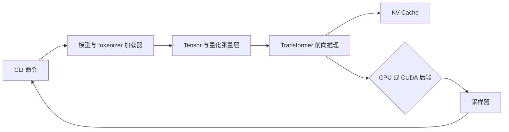
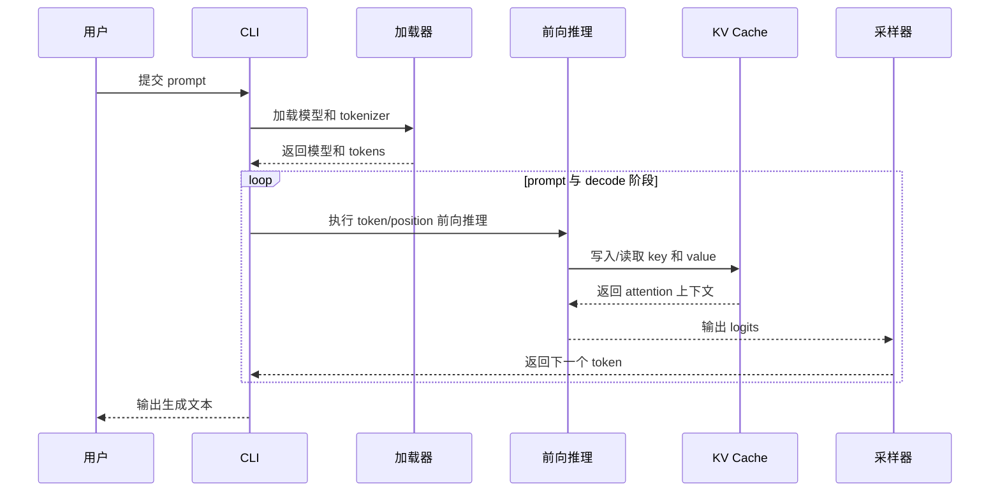

# m_mini_llam

`m_mini_llam` 是一个基于 C++17 的小型 Transformer 推理引擎。项目已支持 CPU 推理，并提供可选的 CUDA 后端。其目标是清晰展示模型执行链路：张量运算、量化线性层、GGUF 加载、分词、KV Cache、采样和命令行演示均在本仓库内实现。

## 当前状态

- CPU 后端：已实现，并由 CTest 覆盖。
- 数值正确性：使用独立 Python 参考实现对比 C++ logits 和生成 token。
- 量化：已包含 F32/模型原生权重、Q8_0、Q4_0 和 Q4_1 路径；CPU 一键测试会对 Q8_0 和 Q4_0 进行性能对比。
- CUDA 后端：通过 `MINI_LLAMA_CUDA=ON` 启用，需要 NVIDIA GPU，不属于 CPU 验证命令的范围。

## 编译与运行

环境要求：CMake 3.18+、支持 C++17 的编译器、用于数值对齐的 Python 3，以及常规构建工具。

```bash
cmake -S . -B build-cpu -DMINI_LLAMA_CUDA=OFF -DMINI_LLAMA_BUILD_TESTS=ON
cmake --build build-cpu --parallel
ctest --test-dir build-cpu --output-on-failure
```

运行 tiny 模型：

```bash
./build-cpu/mini-llama generate \
  --model models/tiny/model.bin \
  --config models/tiny/model.json \
  --tokenizer models/tiny/vocab.json \
  --backend cpu --prompt "hello" --n-predict 8
```

可执行文件还提供 `run`、`inspect`、`inspect-gguf` 和 `bench` 命令。可通过 `./build-cpu/mini-llama --help` 或各子命令的 `--help` 查看参数。

## CPU 一键验证

以下命令会自动配置 CPU 构建、运行全部 CTest、与 Python 对比 logits/token，并对模型原生权重、Q8_0 和 Q4_0 进行性能测试：

```bash
python3 python/run_cpu_tests.py
```

每次运行都会生成 `result/cpu_test_YYYYMMDD_HHMMSS.md`。报告保留完整命令和输出，包括测试状态、对齐误差、prefill/decode 吞吐、权重内存和量化 logits 误差。`result/` 已被 Git 忽略，重复验证不会污染源码树。

## 目录结构

- `include/`、`src/`：推理引擎接口和实现
- `test/`：CPU、CUDA、tokenizer、KV Cache 和前向推理测试
- `python/`：独立参考实现、数值对齐和测试脚本
- `models/tiny/`：用于测试和示例的小型可复现模型
- `models/chat/`：可用时加载聊天模型和 tokenizer 资源

## 架构与数据流





## 技术取舍与 CPU 实测

- **可读参考路径与最大吞吐**：显式保留张量形状和参数校验，便于验证 CPU/CUDA 对齐；代价是部分路径会增加检查和拷贝。
- **量化与数值精度**：tiny 模型的单线程 `RelWithDebInfo` 结果为：原生权重 `146.31` tokens/s、`0.13 MB`；Q8_0 为 `204.75` tokens/s、权重压缩 `2.74x`、最大 logits 误差 `7.412e-4`；Q4_0 为 `282.06` tokens/s、压缩 `3.94x`、最大误差 `1.308e-2`。低精度减少了内存占用，并提高了该样本的速度，但增大了数值误差。
- **独立 Python 参考实现与测试复杂度**：对齐测试逐步比较 logits 和生成 token。当前 CPU 测试覆盖 2 个 prompt、20 个推理步骤，C++ 与 Python 路径的最大绝对误差为 `4.47e-8`。

## CUDA 验证

在具备受支持 NVIDIA GPU 的设备上，运行 `python/run_gpu_tests.py`。该脚本会记录环境检查、构建输出、GPU CTest 结果和可选的 compute-sanitizer 结果。CUDA 结果与 CPU 报告分开保存。

## 已知限制

tiny 模型只是正确性测试样本，不代表真实模型的生成质量或性能。性能数据会受编译器、CPU、线程数、模型和构建类型影响；GPU 数据必须与显卡型号和 CUDA 版本一起报告。
